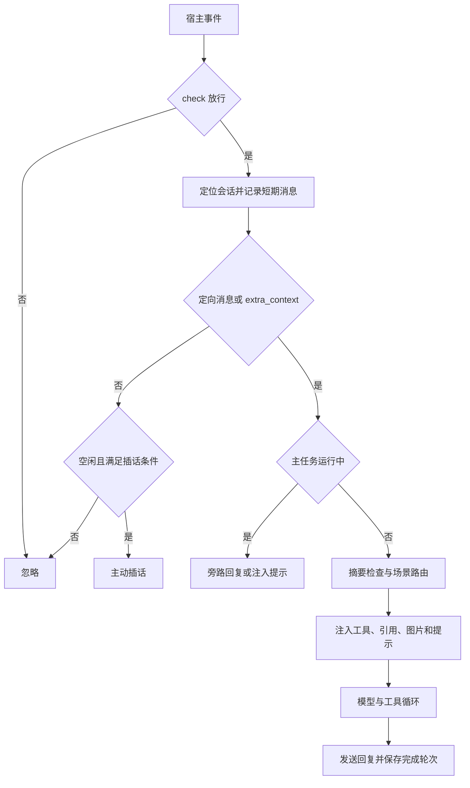

# clovers-agent

Clovers 异步 Agent 核心插件，负责消息准入、会话、路由、模型请求、工具循环、Skill 加载和记忆压缩。当前源码版本 `0.3.9`。

安装与宿主接入见 [仓库首页](../README.md)。本包导出 `PLUGIN`、`AGENT`、`CloversAgent`、`AgentTools`、`Turn`、`Event`、`cast_invoker`。

## 配置

配置模型见 [config.py](clovers_agent/config.py)，通过 `Config.sync_config("clovers_agent")` 接入宿主配置。`api` 没有默认值，使用前必须填写。

### 顶层字段

| 字段                   | 默认值                                     | 含义                                          |
| ---------------------- | ------------------------------------------ | --------------------------------------------- |
| `path`                 | `./data/CloversAgent/`                     | 会话、用量、提示词等数据根目录                |
| `plugins`              | `[]`                                       | Python 工具模块名，如 `clovers_agent_toolkit` |
| `plugin_dirs`          | `["./AgentTools"]`                         | 本地 Python 工具目录                          |
| `skill_dirs`           | `["./AgentSkills", "~/.agents/skills"]`    | Skill 根目录，扫描直接子项，此处展开 `~`      |
| `api`                  | 必填                                       | 默认模型配置                                  |
| `apis`                 | `{}`                                       | 命名模型配置，缺失的用途回退 `api`            |
| `sentence_model`       | `BAAI/bge-small-zh-v1.5`                   | 话题检测使用的句向量模型                      |
| `sentence_model_cache` | `./data/CloversAgent/sentence_model_cache` | 句向量缓存，修改 `path` 不会连带修改它        |
| `max_call_depth`       | `40`                                       | 一条调用链最多请求模型的次数，不是工具总数    |
| `chime_in_cooldown`    | `3600`                                     | 主动插话冷却秒数                              |
| `httpx_timeout`        | `300`                                      | 共享 HTTP 客户端默认超时秒数，部分请求会覆盖  |
| `session`              | 见下表                                     | 记忆与短期窗口配置                            |
| `prompts`              | 见下文                                     | 默认提示词                                    |
| `constant`             | 见源码                                     | 标签、内置工具名称、描述与脚本限制等常量      |
| `check`                | 关闭 / 空列表                              | 消息准入                                      |

相对路径按宿主当前工作目录解释。启动依次加载句向量模型、提示词、Python 插件和 Skill，再同步菜单、验证清单并调度启动钩子。

### 模型接入点

`api` 与 `apis.<用途>` 均使用如下结构：

```json
{
  "url": "https://your-provider.example/v1",
  "model": "your-model",
  "api_key": "your-api-key",
  "extra_body": {}
}
```

请求地址是去除末尾 `/` 后的 `url` 加 `/chat/completions`，使用 Bearer 鉴权。`extra_body` 在构建请求时合并，能覆盖 `model`、`messages` 等字段。当前按完整 JSON 响应解析，不支持流式响应。

网络请求异常、HTTP 429 和 5xx 会重试；模型请求最多尝试 3 次，并非所有 HTTP 错误都会重试。

可选 `vision` 使用相同四个字段，指向独立视觉模型，不支持继续嵌套 `vision`。有此配置时先将图片转写为文字，再交给主模型。

| `apis` 键  | 实际用途                                                                       |
| ---------- | ------------------------------------------------------------------------------ |
| `router`   | 选择场景入口                                                                   |
| `on_chat`  | 内置普通聊天                                                                   |
| `chime_in` | 主动插话                                                                       |
| `summary`  | 历史摘要                                                                       |
| `on_task`  | 官方工具集工作区场景；路由入口名实际为 `on_workspace`                          |
| 自定义键   | intro 实现通过 `agent.api(key)` 选择；纯 Markdown intro 默认使用自身归一化名称 |

旁路使用当前主任务的 API，子代理默认继承创建它的轮次 API。配置一个键不会自动创建对应场景。

### 会话参数 `session`

| 字段              | 默认值  | 含义                                                         |
| ----------------- | ------- | ------------------------------------------------------------ |
| `memory_timeout`  | `86400` | 完成轮次的记忆超时、图片映射保留时间、每日过期清理判断的秒数 |
| `memory_size`     | `240`   | 完成轮次数阈值，严格大于才触发压缩；一轮含输入和最终回复     |
| `silence_timeout` | `3600`  | 短期窗口保留秒数，记录新消息时淘汰旧项                       |
| `silence_size`    | `10`    | 短期消息窗口容量                                             |
| `decouple_length` | `3000`  | 累计字符达到该值后才尝试话题检测，不是 token 上限            |
| `decoupler_alpha` | `0.8`   | 话题向量指数衰减系数                                         |
| `router_size`     | `3`     | 路由参考的最近完成轮次数，窗口仅存于内存                     |

### 准入 `check`

按顺序选择第一个满足的模式：

1. `whitelist` 非空：只接收列表中的群。
2. `blacklist` 非空：接收不在列表中的群。
3. `console_mode=true`：接收所有事件，包括私聊。
4. 否则不接收消息。

两个名单都是字符串列表，白 / 黑名单模式要求 `group_id` 非空。`console_mode` 是放行规则，不会创建独立控制台。

### 提示词覆盖

`reload_prompts()` 优先读取 `{path}/prompts/` 下的非空文件，缺失或为空时使用 `prompts` 对应配置：

| 文件          | 回退字段          | 用途                                         |
| ------------- | ----------------- | -------------------------------------------- |
| `BASE.md`     | `base_prompt`     | 消息标签等基础约定                           |
| `STYLE.md`    | `style_prompt`    | 人设与风格                                   |
| `CHAT.md`     | `chat_prompt`     | 聊天回复规则                                 |
| `ROUTER.md`   | `router_prompt`   | 场景路由                                     |
| `ASIDE.md`    | `aside_prompt`    | 旁路处理，保留用于任务输出的 `{}` 格式占位符 |
| `CHIME_IN.md` | `chime_in_prompt` | 主动插话                                     |

普通聊天系统提示由 STYLE、BASE、CHAT 依次组合；任务场景通常使用 STYLE + BASE。覆盖文件不会自动创建。修改后重启或在宿主代码中调用 `AGENT.reload_prompts()`，没有内置聊天命令。

## 消息与调用链



群会话 ID 为 `group_id`，私聊为 `private-<user_id>`。输入按昵称包装为 `<user name="...">`，定向消息加 `@ME`。适配器提供的 `flat_context` 用于引用消息；可选事件属性 `extra_context` 提供额外上下文。

普通群聊先存入短期窗口，带其他 @、未过冷却或会话忙碌时不请求插话。条件满足后直接请求 `chime_in` 模型，没有额外的“是否插话”分类步骤。携带 `extra_context` 的事件会走正式处理路径。

每个 Session 有 `execute_lock`、`aside_lock`。主任务运行时，新定向消息通常走旁路，旁路可以回复或调用 `inject_prompt` 补充主任务，不会把每条消息都排队为新的正式任务。旁路忙碌或主轮次已空闲时，该分支可能仅保留短期记录。

### 路由、工具与发送

路由前运行 `:router` intro 钩子。只有内置入口时直接普通聊天；多个入口时让路由模型选择。入口函数负责 `create_payload()` 并返回本轮使用的 intro 名，随后注入 `:intrinsic`、该 intro 同名分类的工具，执行 intro 钩子。路由异常回退 `on_chat`。

同一次模型响应内的 `tool_calls` 使用 `asyncio.gather` 并发执行，结果加入上下文后继续请求模型。响应即使同时含工具调用，非空文本也会发送；最终无工具调用的响应结束调用链。`pending_content` 在工具结果后作为新的 user 消息注入。

| 情况             | 返回给模型的工具结果                                       |
| ---------------- | ---------------------------------------------------------- |
| 工具不存在       | `` `name`: not found ``                                    |
| 参数 JSON 不合法 | `` `name`: bad JSON args: ... ``                           |
| 调用签名不匹配   | `` `name`: invalid args: ... ``                            |
| 工具执行异常     | `` `name` failed ``，最近 5 条异常存入内存 `tool_failures` |
| 返回值非字符串   | `` `name` returned bad result ``                           |

框架按 Python 签名调用工具，不完整验证 JSON Schema 的值类型；工具应自行校验。调用链超限或发生异常时保存 `sessions/<id>/payload_*.json` 并停用本轮。

宿主内的 `ChatAgent.send()` 按会话串行发送：不超过 4 个非空行时逐行发送，更多行整段发送，按文本长度等待，单次最多 8 秒。这是完整响应后的分片发送，不是 token 流式输出。

## 记忆与持久化

| 数据                                       | 位置 / 生命周期                                                                                   |
| ------------------------------------------ | ------------------------------------------------------------------------------------------------- |
| 完成轮次                                   | `sessions/<id>/recorder.jsonl`，每行是输入、最终回复、时间戳组成的记录                            |
| 历史摘要                                   | `sessions/<id>/histories/<时间> <随机值>.md`，front matter 含 `overview`、`keywords`、`timestamp` |
| 失败现场                                   | `sessions/<id>/payload_*.json`，包含当次请求上下文                                                |
| 用量                                       | `usages/<日期>.json`，按请求中的模型名累计 API 返回的整数 usage 字段                              |
| 短期消息、图片映射、路由窗口、锁、扩展状态 | 仅存内存                                                                                          |

正式轮次只有最终回复非空才写入完成记录，工具过程和中途文本不作为独立历史轮次保存。普通群聊会在后续回复时并入该轮输入，JSONL 不是完整原始事件日志。

正式输入开始时，已有记录非空且没有待唤醒任务，满足任一条件会尝试摘要：完成轮数 `> memory_size`；最旧记录早于 `memory_timeout`；累计字符达到阈值且检测到话题切换。摘要与路由可并行准备，执行正式轮次前等待摘要完成。

压缩清空完成记录、图片映射、路由窗口、字符计数，删除 `recorder.jsonl`，把摘要插入短期窗口，并写入历史 Markdown。历史文件不会在启动时自动读回上下文，核心没有内置历史检索工具。

每日维护在调度器时区的 02:00 执行：按 `last_active_time` 和 `memory_timeout` 清理缓存会话，删除其 `recorder.jsonl`，取消待唤醒任务，执行会话 `extra["cleanup"]` 协程及插件 `daily_tasks`。摘要目录和工具集工作区文件不会因此自动删除。用量日期及内存累计也在维护时切换，不是零点切换。

图片下载入口支持 PNG、JPEG、WebP、GIF，默认限制 10 MiB，接受 HTTP(S)、支持的 base64 data URI 和本地 `file://`。历史图片改为 `[image:<id>]`，数据映射只在内存保留；重启后无法凭旧标签恢复。

## 扩展与唤醒

- [Python 插件开发](../AgentTools/README.md)：工具、场景、分类和生命周期钩子。
- [Skill 编写](../AgentSkills/README.md)：Markdown 工作流、可选 Python 实现、宿主脚本与资料。
- [官方工具集](../clovers-agent-toolkit/README.md)：文件工作区、搜索、网页提取与调试。

`Turn` 代表一次调用链，`Session` 继承它并增加记忆和锁。`turn.create_turn()` 创建共享会话 ID、扩展状态和用量计数的独立轮次，调用者仍需创建 payload 和输入。

`agent.submit_turn_for_wakeup(turn, event)` 在活动会话上提交后台调用链。系统保留主轮次快照，等待会话空闲及已登记任务完成，再恢复上下文处理结果。该机制只在当前进程内有效，不是持久化任务队列。

## 排查

| 现象                 | 优先核对                                                      |
| -------------------- | ------------------------------------------------------------- |
| 不回复               | 模型必填配置、准入、群号字符串类型、事件 `to_me`              |
| 启动停留在模型加载   | 句向量模型路径、网络与缓存                                    |
| 已安装工具集但没工具 | 核心 `plugins` 是否加入 `clovers_agent_toolkit`               |
| 分类不可见           | 是否声明分类描述、加载插件并调用 `sync_menu()`                |
| 重启后记忆减少       | 是否已摘要或被每日清理；短期窗口本就不落盘                    |
| 模型调用失败         | 宿主日志与 `payload_*.json`；现场文件可能含完整对话和工具内容 |

## License

MIT，见 [LICENSE](LICENSE)。
