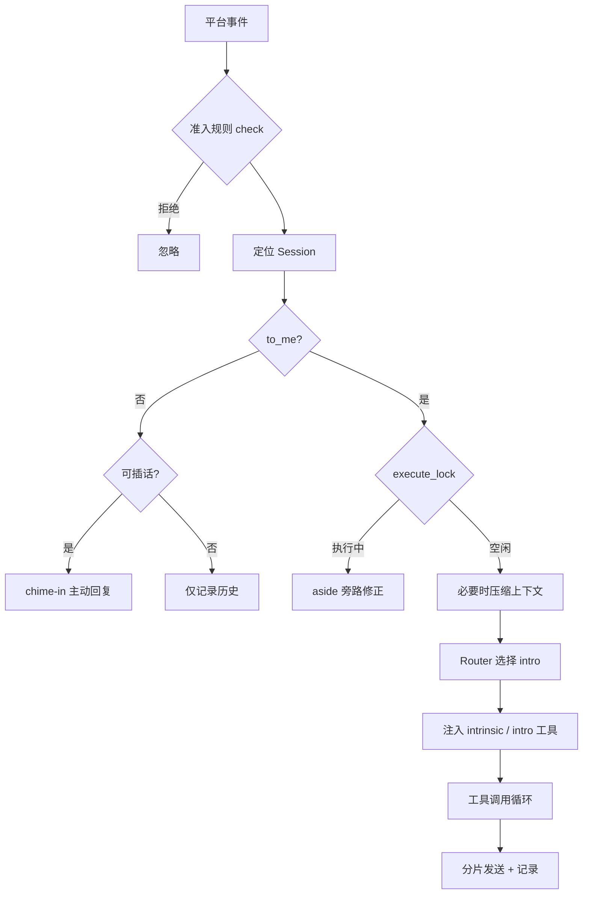

# clovers-agent

**Clovers 的异步群聊 Agent 插件。**
An async, tool-using chat agent for [clovers](https://clovers-project.github.io/), built on OpenAI-compatible APIs.

`clovers-agent` 负责「一个群聊里的 AI 群友」这件事：维护每个会话的记忆，判断消息是在跟它说话还是群友闲聊，按场景加载工具，执行工具调用链，并把结果拆成多条消息发出去。工具与技能都可以在不改核心代码的情况下扩展。

## 特性

- **会话级状态**：按群 / 私聊隔离，JSONL 持久化，进程内缓存，闲置超时清理
- **语义路由**：多个场景（intro）时用轻量模型选场景，避免把所有工具塞进同一次请求
- **工具循环**：单轮最多 `max_call_depth` 步；工具可并行；支持中途注入补充说明
- **Skill 系统**：Markdown 定义工具与分类，`skill.py` 补实现，`scripts/` / `references/` 提供可执行资源
- **记忆压缩**：长度 / 时间 / 话题切换触发，摘要落盘为 Markdown，可继续检索
- **主动插话**：未点名时按冷却时间决定是否接话；执行中收到消息走旁路修正
- **多模型**：默认 / `router` / `chime_in` / `summary` / `on_task` 可分别配置
- **视觉**：`api.vision` 配置后，图片先转写为文字再交给主模型
- **可运维**：token 用量按日统计、失败现场快照、每日会话清理、插件启动 / 关闭钩子

## 工作原理



一次点名对话大致是：

1. 事件通过准入规则，按 `group_id`（群）或 `private-<user_id>`（私聊）找到 `Session`
2. 记录这条消息；若开启了旁路且主任务正在执行，走 `aside` 分支
3. 获取 `execute_lock`，必要时先压缩历史
4. `Router` 在多个 intro 中选择一个（只有一个时直接 `on_chat`）
5. 注入 `:intrinsic` 工具、当前 intro 的工具，以及引用的消息 / 图片
6. 执行 intro 钩子，拼装本轮提示词，进入工具循环
7. 每产出文本就交给 `send`，轮末把输入与最终回复写入 `recorder.jsonl`

## 安装

```bash
pip install clovers-agent
```

或从本工作区安装：

```bash
uv sync --all-packages
```

`clovers-agent` 不是独立进程，需要由 clovers 宿主加载。安装后让宿主启用 `clovers_agent` 插件即可；包内导出 `PLUGIN` 与 `AGENT`。

## 配置

配置由 `clovers_client.Config.sync_config("clovers_agent")` 托管，首次运行生成默认值，字段名即配置键。

### 最小配置

| 键                   | 类型   | 说明                                                      |
| -------------------- | ------ | --------------------------------------------------------- |
| `api.url`            | `str`  | OpenAI 兼容接入点根地址，例如 `https://api.openai.com/v1` |
| `api.model`          | `str`  | 模型名                                                    |
| `api.api_key`        | `str`  | API Key                                                   |
| `check.console_mode` | `bool` | 本地联调时设为 `true`，放行所有事件                       |

### 完整配置

| 键                     | 默认值                                     | 说明                                       |
| ---------------------- | ------------------------------------------ | ------------------------------------------ |
| `path`                 | `./data/CloversAgent/`                     | 数据根目录（会话、用量、提示词、模型缓存） |
| `plugins`              | `[]`                                       | 额外加载的工具插件模块名                   |
| `plugin_dirs`          | `["./AgentTools"]`                         | 本地 Python 工具插件目录                   |
| `skill_dirs`           | `["./AgentSkills", "~/.agents/skills"]`    | Skill 目录，每个子项是一个 skill           |
| `api`                  | 必填                                       | 默认模型接入点                             |
| `apis`                 | `{}`                                       | 命名模型接入点，见下节                     |
| `sentence_model`       | `BAAI/bge-small-zh-v1.5`                   | 句向量模型（话题解耦）                     |
| `sentence_model_cache` | `./data/CloversAgent/sentence_model_cache` | 向量模型缓存目录                           |
| `max_call_depth`       | `40`                                       | 单轮工具调用链上限，超出后按异常处理       |
| `chime_in_cooldown`    | `3600`                                     | 主动插话冷却，单位秒                       |
| `session`              | 见下表                                     | 会话与记忆参数                             |
| `prompts`              | 见「提示词」                               | 默认提示词                                 |
| `constant`             | 见 `constants.py`                          | 内置标签、工具描述等，通常不用改           |
| `check`                | 见「准入规则」                             | 插件级准入控制                             |

#### 模型接入点

`api` 与 `apis.*` 的结构相同：

| 键           | 说明                                                              |
| ------------ | ----------------------------------------------------------------- |
| `url`        | 接入点根地址，请求发往 `{url}/chat/completions`                   |
| `model`      | 模型名（同时作为用量统计的分组键）                                |
| `api_key`    | 鉴权 Key，以 `Authorization: Bearer` 发送                         |
| `extra_body` | 额外请求体，会合并进每个请求（注意不要覆盖 `model` / `messages`） |
| `vision`     | 可选，另一个 `OpenAIConfig`；纯文本模型用它转写图片               |

`apis` 的内置键：

| 键           | 用途                                                                 |
| ------------ | -------------------------------------------------------------------- |
| `router`     | 语义路由；建议用便宜、快的模型                                       |
| `chime_in`   | 主动插话与闲聊回复                                                   |
| `summary`    | 上下文压缩                                                           |
| `on_chat`    | 普通聊天场景                                                         |
| `on_task`    | 官方工具集的任务场景                                                 |
| `<intro 名>` | 任意 intro 也可以单独指定模型，例如 `on_chat` 或自定义的单文件 skill |

未配置的键自动回退到默认 `api`。

#### 会话参数

| 键                | 默认值  | 说明                               |
| ----------------- | ------- | ---------------------------------- |
| `memory_timeout`  | `86400` | 记忆超时（秒），也是图片保留时长   |
| `memory_size`     | `240`   | 触发压缩的对话条数                 |
| `silence_timeout` | `3600`  | 静默窗口（秒），用于拼装当前话题   |
| `silence_size`    | `10`    | 静默窗口最多保留的消息条数         |
| `decouple_length` | `3000`  | 累计字符数超过后才启用话题解耦判断 |
| `decoupler_alpha` | `0.8`   | 话题向量的指数衰减系数             |
| `router_size`     | `3`     | 路由模型参考的历史对话条数         |

#### 准入规则

`check` 的四种模式按优先级生效：

1. `whitelist` 非空：只处理 `group_id` 在白名单内的群消息
2. `blacklist` 非空：只处理 `group_id` 不在黑名单内的群消息
3. `console_mode = true`：处理所有事件
4. 以上都不满足：插件关闭

白 / 黑名单只作用于群聊（`group_id` 为空的消息会被拒绝）；私聊联调请用 `console_mode`。

## 会话与记忆

### 会话 ID

| 事件 | 会话 ID             |
| ---- | ------------------- |
| 群聊 | `group_id`          |
| 私聊 | `private-<user_id>` |

会话按需创建，进程内保存在 `CloversAgent.sessions`，并落在 `{path}/sessions/<session_id>/`。

### 记录与窗口

- `recorder.jsonl` 保存完整对话（用户文本 + 助手回复 + 时间戳），图片以 `[image:<id>]` 占位，原图 URL 存在内存的 `image_recorder`
- `message_history` 是「当前话题」的短窗口，`prompt_text` 由它拼成 `<user name="...">` 格式
- 未点名的消息也会先记录，供插话与后续上下文使用
- 每轮结束后才把整轮写入 `recorder`，因此中途失败不会污染长期记忆

### 压缩

满足任一条件时，在下一次点名对话前触发压缩：

- `recorder` 条数超过 `memory_size`
- 最早一条记录早于 `memory_timeout`
- 累计字符数超过 `decouple_length` 且话题解耦器检测到话题切换

压缩由 `summary` 模型生成 `overview` / `keywords` / `summary`，写入 `{path}/sessions/<id>/histories/<时间> <随机>.md`，并清空 `recorder.jsonl`。历史文件不会被自动删除。

### 并发与旁路

- 每个会话有 `execute_lock`：同一会话的正式轮次串行执行
- `aside_lock`：主任务执行期间收到消息时，`aside` 用独立轮次判断「补充 / 纠正 / 询问进度 / 闲聊」，必要时通过 `inject_prompt` 把内容注入主任务
- `chime_in` 只在未点名、无 @、冷却已过且会话空闲时触发

### 唤醒（wakeup）

`submit_turn_for_wakeup(turn, event)` 把一条独立调用链挂到当前会话的唤醒上下文。当前调用链结束后，Agent 会把这些任务的结果拼成一条唤醒消息，恢复会话继续执行。官方工具集的 `subagent` 就建立在这套机制上。

## 工具系统

### 注册工具

```python
from clovers_agent import AgentTools, CloversAgent, Turn, Event

TOOLS = AgentTools()
TOOLS.create_category("demo", "演示工具组")   # 让分类出现在 load_tools 菜单

@TOOLS.register(
    "echo",
    "原样返回输入文本",
    {"text": {"type": "string", "description": "要回显的文本"}},
    category="demo",
)
async def _(agent: CloversAgent, turn: Turn, event: Event, text: str) -> str:
    return text
```

注册签名：

```python
register(
    name: str,
    description: str,
    parameters: dict[str, JSONSchema] | None = None,
    category: str | Iterable[str] | None = None,
    required: list[str] | None = None,
)
```

- `category=None` 注册为 **intro 工具**（场景入口），会出现在路由菜单
- 指定 `category` 注册为分类内的普通工具
- `required` 缺省等于 `parameters` 的全部键；显式传 `[]` 表示无必填
- 工具函数必须是 `async`，返回 `str`

### 分类与注入

| 分类         | 行为                                                                     |
| ------------ | ------------------------------------------------------------------------ |
| `:intrinsic` | 每轮自动注入，例如 `load_tools`、官方工具集的网络工具                    |
| `:builtin`   | 框架内置工具，由内部流程按需注入（读图、注入提示、压缩）                 |
| `:hidden`    | 不出现在 `load_tools` 菜单；由插件按需显式注入（官方工具集的工作区工具） |
| 普通分类     | 由 `create_category` 声明，进入 `load_tools` 菜单，模型按需加载          |

`load_tools(category)` 会把该分类的工具、分类钩子的提示词、以及 `scripts` / `references` 路径一次性注入当前轮。

### 工具循环与错误

每一轮：

1. 请求模型；若返回 `tool_calls`，并行执行所有工具
2. 追加工具结果；若工具有 `turn.pending_content`，作为新的用户消息追加
3. 继续下一轮，直到模型返回纯文本，或达到 `max_call_depth`

错误处理：

| 情况              | 返回给模型                                        |
| ----------------- | ------------------------------------------------- |
| 工具不存在        | `` `name`: not found ``                           |
| 参数不是合法 JSON | `` `name`: bad JSON args: ... ``                  |
| 参数签名不匹配    | `` `name`: invalid args: ... ``                   |
| 工具抛异常        | `` `name` failed ``，并记入 `agent.tool_failures` |

异常详情只进日志与失败队列，不直接回灌给模型；官方工具集的 `debug_utils` 可以读取这些记录。

### 内置工具

| 工具               | 说明                                   |
| ------------------ | -------------------------------------- |
| `on_chat`          | 默认聊天场景，加载 `chat_prompt`       |
| `load_tools`       | 按分类注入工具与资源                   |
| `read_image_by_id` | 读取上下文里 `[image:<id>]` 对应的原图 |
| `inject_prompt`    | 旁路修正时向主任务注入文本             |
| `compact_context`  | 生成并落盘上下文摘要                   |
| `execute_script`   | 执行已加载 skill 的脚本，路径来自枚举  |
| `read_reference`   | 读取已加载 skill 的引用文件            |

### 脚本与引用

Skill 的 `scripts/` 与 `references/` 会映射为 `<skill_name>/<相对路径>`，随后作为 `execute_script` / `read_reference` 的参数枚举注入。脚本执行：

- `interpreter` 为 `python` / `python3` 时使用当前解释器；留空表示直接执行文件；其他值按命令名执行
- `timeout` 默认 120 秒，最大 1800 秒
- 输出只保留末尾约 1600 字符，超时会被强制终止

## Skill 系统

Skill 是「用 Markdown 描述工具」的扩展方式，细节与示例拆解见 [AgentSkills/README.md](../AgentSkills/README.md)。

### 目录结构

```text
AgentSkills/
└── weather/
    ├── SKILL.md                 # 必需，front matter 定义分类
    ├── 1-weather-report.md      # 工具定义（front matter + 正文）
    ├── skill.py                 # 可选，同名函数负责实现
    ├── scripts/                 # 可选，由 execute_script 执行
    └── references/              # 可选，由 read_reference 读取
```

### 加载规则

- 目录里只有 `SKILL.md`（没有其他 `.md` / `scripts` / `references`）：注册为 **intro 工具**
- 目录里还有内容：`SKILL.md` 的 `name` 作为分类名，正文作为该分类的钩子提示词，其余 `.md` 全部注册为分类工具
- 单独一个 `.md` 文件也可以作为 intro 工具加载
- 名称中的 `-` 会转成 `_`；分类名、工具名、intro 名冲突会直接报错
- 加载失败多数会静默跳过；排查时看启动日志里的 `[LOAD SKILL]`，以及 manifest 中是否出现目标分类 / 工具

### `skill.py`

与 Markdown 工具同名的函数会接到该工具上，签名固定为：

```python
async def weather_report(
    agent: CloversAgent,
    turn: Turn,
    event: Event,
    content: str,      # Markdown 正文，由框架传入
    city: str,         # 前端 parameters 声明的参数
) -> str:
    ...
```

`content` 总是以关键字传入；可以用它做模板渲染（`weather` 示例就是 `content.format(**kwargs)`）。没有同名函数时，工具直接返回 Markdown 正文。

## 提示词

启动时读取 `{path}/prompts/` 下的文件，存在则覆盖 `config.prompts` 中的默认值：

| 文件          | 用途                                   |
| ------------- | -------------------------------------- |
| `BASE.md`     | 基础系统提示（消息格式、@ME 语义）     |
| `STYLE.md`    | 人设与口吻，追加到 intro 与聊天提示    |
| `CHAT.md`     | 聊天回复准则                           |
| `CHIME_IN.md` | 主动插话                               |
| `ROUTER.md`   | 路由模型                               |
| `ASIDE.md`    | 旁路修正（含 `{current_output}` 占位） |

提示词只在启动时加载；没有内置的热重载命令，修改后需重启宿主。

## 数据目录

```text
{path}/
├── sessions/
│   └── <session_id>/
│       ├── recorder.jsonl              # 对话记录
│       ├── histories/*.md              # 压缩后的摘要
│       └── payload_*.json              # 失败现场（含完整请求体）
├── usages/
│   └── YYYY-MM-DD.json                 # 按模型的 token 用量
├── prompts/                            # 自定义提示词
└── sentence_model_cache/               # 向量模型缓存
```

- 每日 02:00 执行维护：清理 `last_active_time` 超过 `memory_timeout` 的会话，删除其 `recorder.jsonl`，执行插件注册的 `cleanup` 协程，并切换用量文件
- `usage_counter` 以模型名为键累计 `total_tokens` 等字段；每轮对话结束后落盘
- 失败快照会保留完整上下文，注意其中的用户隐私与磁盘占用

## 扩展

### Python 工具插件

把模块放进 `plugin_dirs`（默认 `./AgentTools`），或通过 `plugins` 指定已安装模块。模块必须导出 `TOOLS = AgentTools()`，写法见 [AgentTools/README.md](../AgentTools/README.md)。

### 生命周期与钩子

| 钩子                | 用法                                                        |
| ------------------- | ----------------------------------------------------------- |
| `on_startup`        | 插件启动协程，`agent.startup()` 时并发执行                  |
| `on_shutdown`       | 关闭协程，`agent.shutdown()` 时最多等待 30 秒               |
| `on_intro(name)`    | intro 被选中时的钩子，返回的文本加入系统提示                |
| `on_category(name)` | 分类被 `load_tools` 加载时的钩子                            |
| `daily_tasks`       | 在启动钩子里 `agent.daily_tasks.append(fn)`，每日维护时执行 |

### 可访问的运行时对象

| 对象    | 常用成员                                                                                                                          |
| ------- | --------------------------------------------------------------------------------------------------------------------------------- |
| `agent` | `api(key)`、`current_session(id)`、`sessions`、`send`、`usage_counter`、`tool_failures`、`extra`、`submit_turn_for_wakeup`        |
| `turn`  | `payload`、`extend_tools`、`upsert_tool`、`extend_scripts`、`extend_references`、`pending_content`、`unit_prompts`、`create_turn` |
| `event` | `send(type, data)`、`call("flat_context")`、`image_list`、`at`、`to_me`、`properties`                                             |

## 安全

- **Skill 即代码**：加载 skill 时会执行 `skill.py`（`importlib`），`execute_script` 会运行任意已映射脚本；只放行可信来源
- **提示注入**：工具结果与用户消息都会进入模型上下文，注意工具输出中的指令性文本
- **密钥**：`api_key` 以明文存在配置中，确保配置文件权限与版本控制忽略
- **隐私**：失败快照与 `recorder.jsonl` 可能包含完整用户内容与图片 URL

## License

MIT，见 [LICENSE](LICENSE)。
